# Getting Started with Sonic on Nokia IXR 7250 Chassis

- [Installation Basics](#install)
    - [7250 IXR chassis](#ixr7250)
    - [Control Processing Module (CPM)](#cpm)
    - [Integrated Media Modules (IMMs)](#imm)
    - [Management connectivity](#mgmt_conn)
- [SONiC Chassis caveats](#caveats)
    - [Platform summary](#platform_summary)
    - [Card details](#card_details)
    - [Interface naming](#intf_numbering)
    - [Internal IP addresses for fabric interfaces](#internal_ip)
    - [config_db](#config_db)
- [Platform Drivers](#platform_drivers)
- [Nokia pre-installed Topology](#predef_topo)
- [Troubleshooting](#troubleshoot)
- [Known issues and limitations](#known_issues)


# Installation Basics <a name="install"></a>

## Description

This section provides the initial procedure to be followed to install SONiC on Nokia 7250 IXR.

## 1 Chassis Booting and Installation Prerequisites

### 1.1 7250 IXR chassis <a name="ixr7250"></a>
The 7250 IXR chassis is offered in two separate configurations, one providing for four IMM slots (7250 IXR-6) and the other providing for eight IMM slots (7250 IXR-10).  Both configurations provide for two CPM slots, however SONiC for 7250 IXR only supports a single CPM card at present.  CPM should always go in the left most CPM slot 'A'.

For more details regarding 7250 IXR chassis specifics please reference the **"7250 IXR-6 and 7250 IXR-10 Chassis Installation Guide"**.

The 7250 IXR-10 chassis is shown in the figure below, including IMMs, CPMs, and PSUs. 

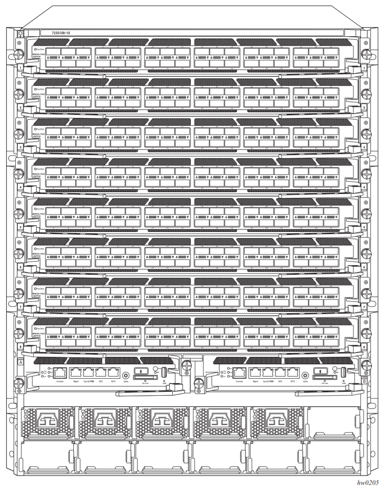

 7250 IXR-10 chassis slot IDs for IMMs, CPMs, and PSUs are shown in the figure below.

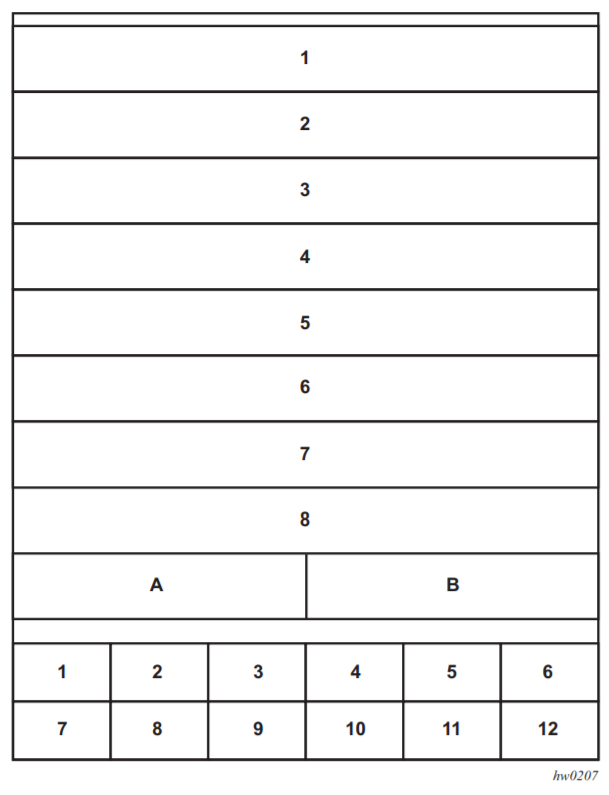

### 1.2 Control Processing Module (CPM) <a name="cpm"></a>
7250 IXR CPM is shown in the figure below.

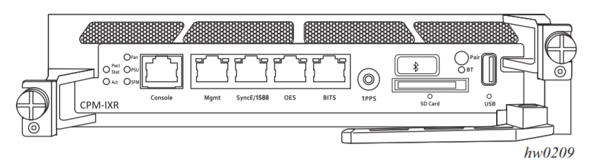

The CPM runs the ONIE install environment, which is made available to the administrator via the CPM front panel Console port, as shown in the figure above.  CPM's initial SONiC image is installed using one of the standard ONIE installation methods.   


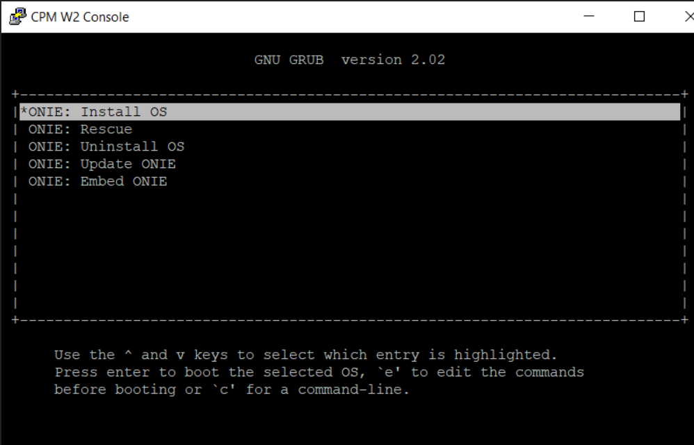

The SONiC image to be installed can be provided either by download from an IP reachable server via the front panel Ethernet management interface or by inserting a USB stick or SD card which has been preloaded with the appropriate image into the front panel.  Either of these methods can be used in conjunction with the ONIE installer Discovery process or with the onie-nos-install command while directly specifying the image file name to be loaded.

Please refer to the Open Compute Project [ONIE](https://opencomputeproject.github.io/onie/) website for details on ONIE Installer Discovery Methods and the **onie-nos-install** command. 

If  CPM SONiC install is to be executed using an IP reachable image server then first ensure the [Management Connectivity](#mgmt_conn) section instructions are followed such that the front panel Ethernet management interface has been properly configured. 

Nokia will provide the SONiC binary install file with a name similar to **sonic-broadcom-xxxxxxxx.bin**, where xxxxxxxx is a unique hash identifier.  This image can then be symlinked on the Data Center's HTTP server as follows so that CPM can find it at SONiC install time.

> ***$ ln -s sonic-broadcom-xxxxxxxx.bin onie-installer-nokia_ixr7250***


The figure below illustrates use of the onie-nos-install command to install SONiC image.

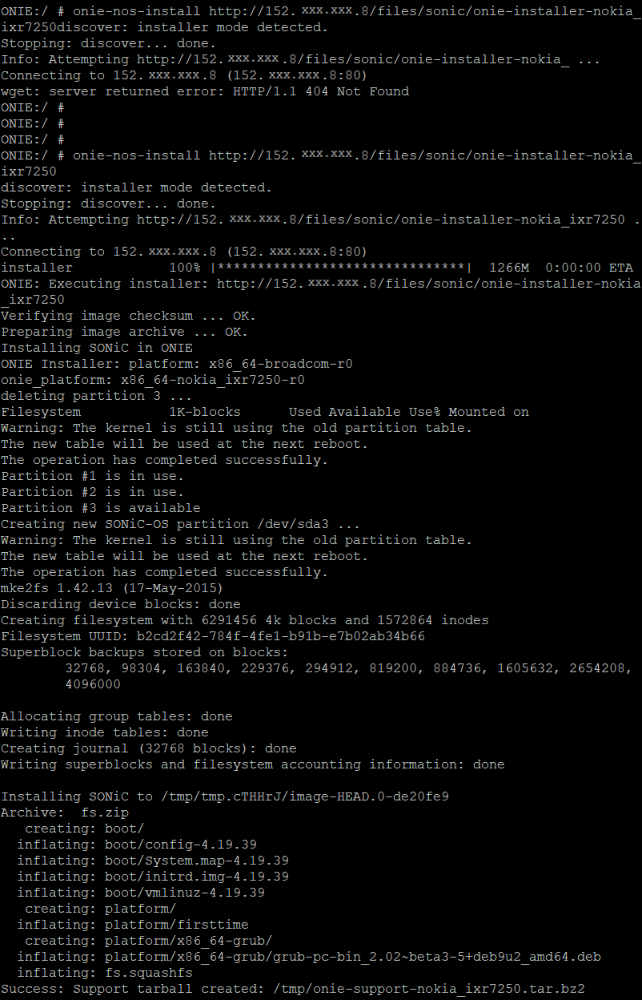


After the installation has completed CPM will reboot and automatically run the newly installed SONiC image.

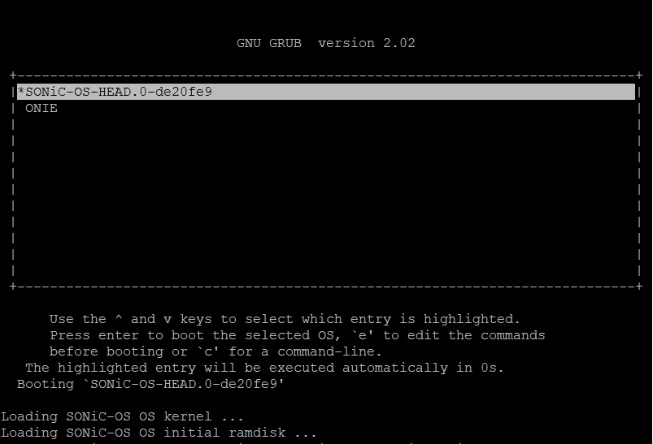


Once inside the SONiC environment the **sonic_installer list** command can be used to show the installed images, as illustrated below.

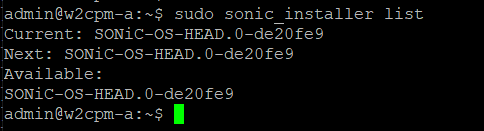


After the initial SONiC image has been installed, subsequent SONiC images can then be installed directly from the SONiC operating environment using the **sonic_installer install**  command.  Using this method allows for multiple SONiC build revisions to coexist within the local SONiC-OS partition, as shown in the figure below using the **sonic_installer list** command.


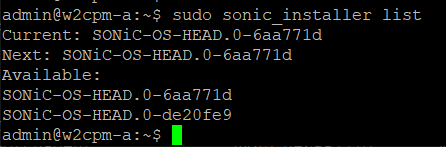


A new SONiC image can also subsequently be installed from the ONIE environment as previously described, but note that if this method is used any previous SONiC-OS partition (along with any SONiC installations contained therein) will be destroyed and overwritten with the new image.  Any non-default SONiC configuration settings are also lost when installing from the ONIE environment and will need to be reconfigured.


### 1.3 Integrated Media Modules (IMMs)  <a name="imm"></a>

IMMs also run the ONIE install environment, however they typically download and install their SONiC image directly from the CPM (via 7250 IXR Ethernet midplane).  The SONiC image to be installed on IMMs should be placed on the CPM filesystem at **/etc/sonic/nokia/onie-installer-nokia_ixr7250**.    When the IMM ONIE install discovery process is triggered the SONiC image to be installed is automatically fetched from the CPM at this location.

Note that, currently, the CPM HTTP server must be manually launched in order to serve install files to IMMs.  First check at this chassis' CPM to see if the CPM HTTP server is running using the **netstat -ln** command below.  If there is a listener found on port 8080, as shown below, then the HTTP server is already started and the CPM is ready to serve IMM images.

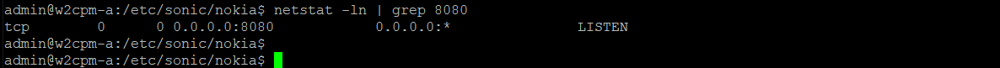

If there is no port 8080 listener found then the CPM HTTP server needs to be (re)started, as shown below.  Be sure to launch the HTTP server from the directory where the image to be served to IMMs resides.

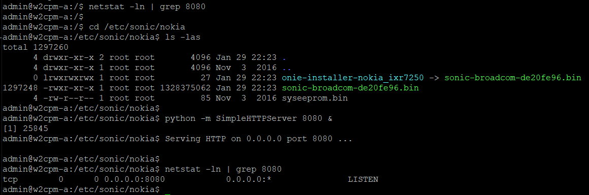


Once the initial SONiC image has been installed on an IMM, subsequent SONiC images can then be installed directly from the SONiC operating environment using the **sonic_installer install**  command to download and install an image directly from the CPM, as shown below. The midplane CPM address is 10.0.0.16.  Using this method allows for multiple SONiC build revisions to coexist within the local SONiC-OS partition.

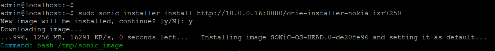


A new SONiC image can also subsequently be installed from ONIE install environment as previously described, but note that this method is destructive to any existing SONiC installations.  When this ONIE install method is used the existing SONiC-OS partition (along with any SONiC installations contained therein) will be overwritten with the newly specified SONiC install image. 


### 1.4 Management connectivity  <a name="mgmt_conn"></a>

Management connectivity for all cards within the 7250 IXR chassis is provided via the CPM front panel Ethernet Management interface (eth0).  Ensure that this interface is connected to an appropriate ethernet switch/router so as to provide connectivity into the Data Center network infrastructure.  

#### 1.4.1 CPM Manageability

While the CPM Mgmt interface can be configured with a static IP address if required, optimally a DHCP server will be available within the Data Center infrastructure to provide CPM with an IP address automatically via DHCP.  At present It is recommended to extract the CPM Mgmt interface MAC address, using the instructions provided below, and then configure the infrastructure DHCP server with a non-changing/static IP address that will be provided to CPM when its DHCP request arrives.  In the future it will be possible to use the unique 7250 IXR chassis serial number for this purpose instead of CPM MAC address.


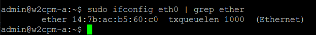


The figure below depicts the commands required in order to manually configure the CPM Mgmt interface with a static IP address, in the event that using DHCP is not an option.  The first command configures the CPM Mgmt interface with address 10.3.152.115 and the second sets up a default route using the appropriate gateway by way of the CPM Mgmt interface.


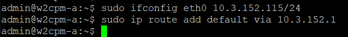


#### 1.4.2 IMM Manageability

Each IMM has a well known address automatically configured for its internal control plane ([midplane](#midplane)) interface in the form of 10.0.0.<slot>. So, an IMM in slot 3 has an internal address of 10.0.0.3 and an IMM in slot 6 has an internal address of 10.0.0.6.  Each IMM can be managed directly from CPM by using SSH to connect to the IMM internal control plane address, as illustrated below for the slot 3 IMM.

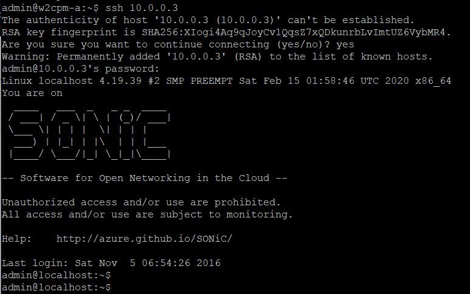


Each IMM can also be externally managed by way of an external facing IP address that is configured at the CPM.  This scheme is described in the next section.


#### 1.4.3 CPM Configuration for External IMM Manageability

IMM external manageability is indirectly provided by proxy via the CPM front panel ethernet management port.  Each IMM residing in an 7250 IXR chassis requires its own pre-allocated IP address to support this proxy management scheme. Thus, the number of IP addresses required is the number of IMM cards present in the chassis (one address each) plus one for the CPM front panel mgmt interface.   Since the chassis can support a maximum of eight IMMs, the total number of addresses required to support a fully populated chassis is nine.    

The simplest way to pre-allocate the necessary addresses is for the administrator to provide a linear block of nine addresses where the base (lowest) IP address is mapped by the infrastructure DHCP server to the CPM MAC address and then each IMM gets one of the remaining addresses to use in conjunction with the proxy manageability scheme described above.  

While it is possible to configure the IMM external facing proxy address using a different scheme, it is recommended to use a linear block of addresses.

Each external facing IMM address must be configured at the CPM using the **ixr7250_mgmt_nat.sh** command, with IMM slot passed as parameter one and the desired (administrator provided) external facing IP address as parameter two.  The **ixr7250_mgmt_show_nat.sh** command can then be used to display external facing IP address to IMM internal address/slot mappings, as shown in the figure below.

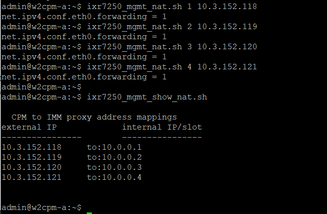


#### 1.4.4 Rolling up CPM configuration

Once the IP external facing address to IMM internal address mappings are determined, the appropriate configuration commands can then be rolled up into a monolithic script file for execution after subsequent CPM reboots.  Since these configuration commands are not currently executed automatically when the CPM is rebooted, they must be manually executed once the CPM has booted.   The figure below shows an example configuration script named **config_mgmt**, which contains the commands required to manually configure the CPM front panel eth mgmt interface IP address (in the absence of DHCP) and to map external facing IP addresses for the IMMs in slot 1 and slot 2. 


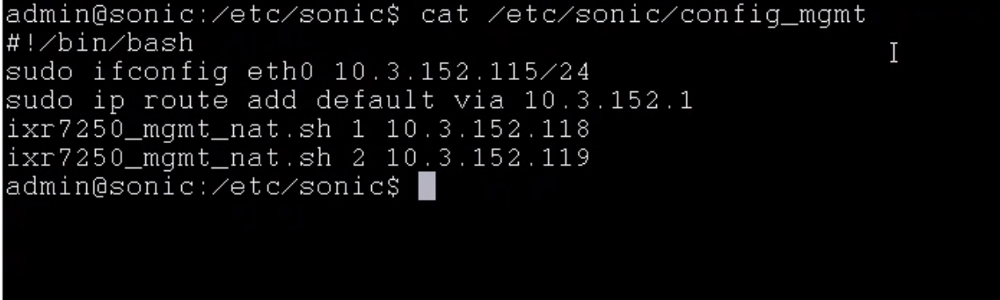


Note that any configuration file placed in the /etc/sonic directory will be automatically copied to the /etc/sonic/old_config directory when a new SONiC image is installed using the **sonic_installer install** command.  Any configuration files that exist in the /etc/sonic/old_config directory, however, will be lost when a new SONiC image is installed this way so care must be taken after a new image install to ensure that any important configuration files residing in /etc/sonic/old_config are manually copied to /etc/sonic if they need to be retained the next time an image upgrade occurs.


## 2. SONiC Chassis caveats <a name="caveats"></a>

This section provides additional information specific to running SONiC on a chassis information that is not yet available on the OC.

## Platform summary <a name="platform_summary"></a>

- Linecard: 'show platform summary' on a line card will show:

```
Platform: x86_64-nokia_ixr7250-r0
HwSKU: imm36-400g-qsfpdd
ASIC: broadcom
```
- CPM:  "show platform summary" on CPM will show:

```
Platform: x86_64-nokia_ixr7250-r0
HwSKU: CPM
ASIC: broadcom
```

## Card details <a name="card_details"></a>
This card_details.json file is generated by the device manager based on the slot which this line card is currently inserted. Fields in the card_details are:
-   hwsku: The HWSKU name of the card 
-   num_asics: Number of ASICs on this card 
-   slot_num: The slot number of this card is currently operating in
-   active_cpm_slot_num: The slot of the active CPM card
-   is_cpm:  "Yes"/"No" to indicates if this card is CPM (Contorl Card) or IOM (Line card) 
-   chassis_num_asics:  Maximum number of ASICs this chassis is able to supports


Card details of an IMM is as follows:
```
cat /etc/sonic/card_details.json
{
 "hwsku": "imm36-400g-qsfpdd",
 "num_asics": 1,
 "slot_num": 8,
 "active_cpm_slot_num": 16,
 "is_cpm": "No"
 "chassis_num_asics": 24
}
```

Card details of the CPM is as follows:
```
cat /etc/sonic/card_details.json
{
 "hwsku": "CPM",
 "num_asics": 0,
 "slot_num": 16,
 "active_cpm_slot_num": 16,
 "is_cpm": "Yes",
 "chassis_num_asics": 24
}
```

### Interface naming <a name="intf_numbering"></a>

The interface names contain the port and the line card (slot) number. The format of the interface name is Ethernet<portNum>s<slotNum>. portNum is from 1..36.

For example, a "show interface status" on slot #8 will return:

```
   Interface                    Lanes    Speed    MTU         Alias    Vlan    Oper    Admin             Type    Asym PFC
------------  -----------------------  -------  -----  ------------  ------  ------  -------  ---------------  ----------
 Ethernet1s8                      0,1     100G   9100   Ethernet1s8  routed    down     down              N/A         N/A
 Ethernet2s8                      2,3     100G   9100   Ethernet2s8  routed    down     down              N/A         N/A
 Ethernet3s8                      4,5     100G   9100   Ethernet3s8  routed    down     down              N/A         N/A
<snip>
Ethernet10s8                    10,11     100G   9100  Ethernet10s8  routed    down     down              N/A         N/A
Ethernet11s8                    12,13     100G   9100  Ethernet11s8  routed    down     down              N/A         N/A
Ethernet12s8                    14,15     100G   9100  Ethernet12s8  routed    down     down              N/A         N/A
Ethernet13s8                    32,33     100G   9100  Ethernet13s8  routed    down     down              N/A         N/A
<snip>
Ethernet23s8                    92,93     100G   9100  Ethernet23s8  routed      up       up  QSFP28 or later         N/A
Ethernet24s8                    94,95     100G   9100  Ethernet24s8  routed      up       up  QSFP28 or later         N/A
Ethernet25s8                    40,41     100G   9100  Ethernet25s8  routed    down     down              N/A         N/A
Ethernet26s8                    42,43     100G   9100  Ethernet26s8  routed    down     down              N/A         N/A
<snip>
Ethernet32s8                    78,79     100G   9100  Ethernet32s8  routed    down     down              N/A         N/A
Ethernet33s8  56,57,58,59,60,61,62,63     400G   9100  Ethernet33s8  routed    down     down              N/A         N/A
Ethernet34s8  80,81,82,83,84,85,86,87     400G   9100  Ethernet34s8  routed    down     down              N/A         N/A
Ethernet35s8  64,65,66,67,68,69,70,71     400G   9100  Ethernet35s8  routed    down     down              N/A         N/A
Ethernet36s8  48,49,50,51,52,53,54,55     400G   9100  Ethernet36s8  routed    down     down              N/A         N/A"

```

    
## Internal IP addresses <a name="internal_ip"></a>

### Fabric interface 
Each asic in the chassis is assigned an internal global asic number. This global asic number is '((slot_num - 1) * max_asics_in_a_slot)'. For all Nokia linecards, the max_asics_in_a_slot is currently 3. 

For each asic, we create an internal interface 'asic<global_asic_num>' to communicate with other asics over the fabric. This interface is also assigned an internal IP address '3.3.3.<global_asic_num + 1>/32' for iBGP connectivity across the fabric.


### Midplane interface <a name="midplane"> </a>

Midplane is the chassis 7250ixr internal control plane for communication between the chassis cards. Each IMM has a well known address automatically configured for its internal midplane interface in the form of 10.0.0.<slot>. This interface on the linecard is 'enp12s0f1.2'.

### Example

So, for linecard in slot 8
- the global asic number would be 21.
- the internal interface name would be asic21
- the internal IP address for iBGP connectivity would be 3.3.3.22/32
- the control plane IP address would be 10.0.0.8/32

"show ip interface" reflects the fabric interfaces as follows:

```
Interface     Master    IPv4 address/mask    Admin/Oper    BGP Neighbor    Neighbor IP
------------  --------  -------------------  ------------  --------------  -------------
Ethernet23s8            100.0.0.2/24         up/up         VM0100          100.0.0.1
Ethernet24s8            101.0.0.2/24         up/up         VM0101          101.0.0.1
Loopback0               10.1.0.1/32          up/up         N/A             N/A
asic21                  3.3.3.22/32          up/up         imm2_asic0      3.3.3.19
docker0                 240.127.1.1/24       up/down       N/A             N/A
enp12s0f1.2             10.0.0.8/24          up/up         N/A             N/A
lo                      127.0.0.1/8          up/up         N/A             N/A
```

## config_db <a name="config_db"></a>
A dump of the config_db.json:

```
cat /etc/sonic/config_db.json

    "BGP_NEIGHBOR": {
        "102.0.0.1": {
            "asn": "75102",
            "holdtime": "180",
            "keepalive": "60",
            "local_addr": "102.0.0.2",
            "name": "VM0102",
            "nhopself": "0",
            "rrclient": "0"
        },
        "103.0.0.1": {
            "asn": "75103",
            "holdtime": "180",
            "keepalive": "60",
            "local_addr": "103.0.0.2",
            "name": "VM0103",
            "nhopself": "0",
            "rrclient": "0"
        },
        "3.3.3.22": {
            "asn": "65000",
            "holdtime": "180",
            "keepalive": "60",
            "local_addr": "3.3.3.19",
            "name": "imm1_asic0",
            "nhopself": "0",
            "rrclient": "0"
        }
    },
    "DEVICE_METADATA": {
        "localhost": {
            "bgp_asn": "65000",
            "default_bgp_status": "up",
            "default_pfcwd_status": "disable",
            "deployment_id": "1",
            "docker_routing_config_mode": "unified",
            "hostname": "dut1-imm2",
            "hwsku": "imm36-400g-qsfpdd",
            "mac": "14:7b:ac:3a:c9:7f",
            "platform": "x86_64-nokia_ixr7250-r0",
            "type": "ToRRouter",
            "voq_db": "voqdb.json"
        },
        "voq": {
            "max_cores": "48",
            "my_switch_id": "36",
            "db_file": "voqdb.json",
            "server_ip": "",
            "service_port": ""
        }
    },
    "DEVICE_NEIGHBOR_METADATA": {
        "VM0102": {},
        "VM0103": {},
        "imm1_asic0": {}
    },
    "INTERFACE": {
        "Ethernet25s7": {},
        "Ethernet26s7": {},
        "asic18": {},
        "asic18|3.3.3.19/32": {},
        "Ethernet25s7|102.0.0.2/24": {},
        "Ethernet26s7|103.0.0.2/24": {}
    },
    "LOOPBACK_INTERFACE": {
        "Loopback0": {},
        "Loopback0|10.1.0.2/32": {}
    },
    "PORT": {
        "Ethernet1s7": {
            "admin_status": "down",
            "alias": "Ethernet1s7",
            "index": "1",
            "lanes": "0,1",
            "mtu": "9100",
            "speed": "100000"
        },
        "Ethernet2s7": {
            "admin_status": "down",
            "alias": "Ethernet2s7",
            "index": "2",
            "lanes": "2,3",
            "mtu": "9100",
            "speed": "100000"
        },
        "Ethernet3s7": {
            "admin_status": "down",
            "alias": "Ethernet3s7",
            "index": "3",
            "lanes": "4,5",
            "mtu": "9100",
            "speed": "100000"
        },
<snip>
        "Ethernet36s7": {
            "admin_status": "down",
            "alias": "Ethernet36s7",
            "index": "36",
            "lanes": "48,49,50,51,52,53,54,55",
            "mtu": "9100",
            "speed": "400000"
        }
    },
    "VERSIONS": {
        "DATABASE": {
            "VERSION": "version_1_0_1"
        }
    }
}
```

## Platform Drivers <a name="platform_drivers"></a>
The platform code on the control-card is responsible for ensuring all the components of the chassis are operationally UP. Similarly, the platform code on the line-card will monitor it's components are operationally UP.

In the current beta release, the user-space peripheral drivers are packaged as a separate docker, to keep it modular and conform with the containarization methodology.  In future release, the platform code can be a debian package that can run contain libraries/binaries and run as part of the PMON docker. 

Platform drivers shows up as new docker instance - 'device-manager'
```
CONTAINER ID        IMAGE                                COMMAND                        CREATED             STATUS              PORTS               NAMES
a84ed30c5946        docker-device-manager:latest         /tini -- fixuid -q \u2026"     14 minutes ago      Up 14 minutes                           device-manager
039cdfb510ae        docker-snmp-sv2:latest               "/usr/bin/supervisord"         2 days ago          Up 11 minutes                           snmp
97861500e6c2        docker-router-advertiser:latest      "/usr/bin/supervisord"         2 days ago          Up 13 minutes                           radv
9f81b3ff968b        docker-lldp-sv2:latest               "/usr/bin/supervisord"         2 days ago          Up 13 minutes                           lldp
0feed8a4c1e4        docker-sonic-mgmt-framework:latest   "/usr/bin/supervisord"         2 days ago          Up 13 minutes                           mgmt-framework
c3fd08b25ca9        docker-dhcp-relay:latest             "/usr/bin/docker_ini\u2026"    2 days ago          Up 13 minutes                           dhcp_relay
5a1858a5457b        docker-syncd-brcm:latest             "/usr/bin/supervisord"         2 days ago          Up 13 minutes                           syncd
c75e55e21aeb        docker-teamd:latest                  "/usr/bin/supervisord"         2 days ago          Up 13 minutes                           teamd
520d53652290        docker-orchagent:latest              "/usr/bin/supervisord"         2 days ago          Up 13 minutes                           swss
9e8839d661e3        docker-platform-monitor:latest       "/usr/bin/docker_ini\u2026"    2 days ago          Up 13 minutes                           pmon
da2fc0460c6a        docker-fpm-frr:latest                "/usr/bin/supervisord"         2 days ago          Up 13 minutes                           bgp
46c3d99c9a4f        docker-database:latest               "/usr/local/bin/dock\u2026"    2 days ago          Up 13 minutes                           database
```

## 3. Nokia pre-installed Topology <a name="predef_topo"></a>

The pre-installed configuration on the staged chassis' assume the physical connectivity in the diagram below. The logical topology (routing configuration) details are also in the diagram.

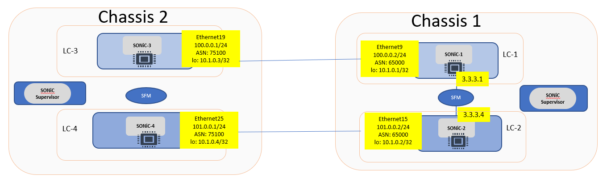

In the above topology, Chassis1 is acting as a SONiC Chassis with the 2 linecards LC-1 and LC-2 with full-mesh iBGP fabric connectivity. 3.3.3.x address are the internal IP's for the iBGP connectivity.

LC-3 and LC-4 in Chassis2 have no fabric connectivity between them (no iBGP pers) - and thus being used as individual pizza boxes. They provide eBGP connections to the Chassis1.

### BGP connectivity

#### Chassis1

- LC-1: We have 1 eBGP peer to LC-3 (100.0.0.1) and 1 iBGP peer to LC-2 over the fabric (3.3.3.4)
```
admin@sonic:~$ show ip bgp summary

Neighbor        V         AS MsgRcvd MsgSent   TblVer  InQ OutQ  Up/Down State/PfxRcd   NeighborName
100.0.0.1       4      75100      58      60        0    0    0 00:47:03            3   board3_t3
3.3.3.4         4      65000      96      95        0    0    0 01:26:13            5   imm2_asic0

Total number of neighbors 2
```

- LC-2:  We have 1 eBGP peer to LC-4 (200.0.0.1) and 1 iBGP peer to LC-1 over the fabric (3.3.3.1)
```
admin@sonic:~$ show ip bgp summary

Neighbor        V         AS MsgRcvd MsgSent   TblVer  InQ OutQ  Up/Down State/PfxRcd   NeighborName
3.3.3.1         4      65000     100     101        0    0    0 01:31:08            5   imm1_asic0
101.0.0.1       4      75200      62      64        0    0    0 00:51:45            3   board4_t1

Total number of neighbors 2
```

#### Chassis2:

- LC-3: We have only 1 eBGP peer to LC-1 (100.0.0.2)
```
admin@dut1:~$ show ip bgp summary

Neighbor        V         AS MsgRcvd MsgSent   TblVer  InQ OutQ  Up/Down State/PfxRcd   NeighborName
100.0.0.2       4      65000      67      65        0    0    0 00:54:50            8   dut1_imm1

Total number of neighbors 1
```

- LC-4: We have only 1 eBGP peer to LC-2 (200.0.0.2)
```
admin@dut1:~$ show ip bgp summary

Neighbor        V         AS MsgRcvd MsgSent   TblVer  InQ OutQ  Up/Down State/PfxRcd   NeighborName
200.0.0.2       4      65000      72      70        0    0    0 00:54:39            8   dut1_imm2

Total number of neighbors 1
```

### IP Routes
Each linecard has a single loopback address 10.1.0.<LC#>. 
-   10.1.0.1 on LC-1
-   10.1.0.2 on LC-2
-   10.1.0.3 on LC-3
-   10.1.0.4 on LC-4

These routes are redistributed over BGP using the 'redistribute connected' config in FRR. These loopback routes should be present in all linecards with the appropriate next hop.

- LC-1: 
    - 10.1.0.1 is directly connected.
    - 10.1.0.2 is learned over fabric from LC-2 (3.3.3.4)
    - 10.1.0.3 is learned over eBGP from LC-3 (100.0.0.1)
    - 10.1.0.4 is learned over fabric from eBGP peer on LC-2 to LC-4 (101.0.0.1)
```
admin@sonic:~$ show ip route

C>* 3.3.3.1/32 is directly connected, asic0, 01:26:20
B   3.3.3.4/32 [200/0] via 3.3.3.4 (recursive), 00:33:59
                         via 3.3.3.4, asic3 onlink, 00:33:59
K>* 3.3.3.4/32 [0/0] is directly connected, asic3, 01:26:19
C>* 10.0.0.0/24 is directly connected, enp12s0f1.2, 01:28:24
C>* 10.1.0.1/32 is directly connected, Loopback0, 01:28:14
B>  10.1.0.2/32 [200/0] via 3.3.3.4 (recursive), 01:26:15
  *                       via 3.3.3.4, asic3 onlink, 01:26:15
B>* 10.1.0.3/32 [20/0] via 100.0.0.1, Ethernet9s1, 00:47:05
B>  10.1.0.4/32 [200/0] via 101.0.0.1 (recursive), 00:46:52
  *                       via 101.0.0.1, Ethernet15s2 onlink, 00:46:52
C>* 100.0.0.0/24 is directly connected, Ethernet9s1, 00:49:33
B>  101.0.0.0/24 [200/0] via 3.3.3.4 (recursive), 00:33:59
  *                        via 3.3.3.4, asic3 onlink, 00:33:59
```

- LC-2:
    - 10.1.0.1 is learned over fabric from LC-1 (3.3.3.1)
    - 10.1.0.2 is directly connected
    - 10.1.0.3 is learned over fabric from eBGP peer on LC-1 to LC-3(100.0.0.1)
    - 10.1.0.4 is learned over eBGP from LC-43 (101.0.0.1)
```
admin@sonic:~$ show ip route

B   3.3.3.1/32 [200/0] via 3.3.3.1 (recursive), 00:39:33
                         via 3.3.3.1, asic0 onlink, 00:39:33
K>* 3.3.3.1/32 [0/0] is directly connected, asic0, 01:31:11
C>* 3.3.3.4/32 is directly connected, asic3, 01:31:12
C>* 10.0.0.0/24 is directly connected, enp12s0f1.2, 01:33:16
B>  10.1.0.1/32 [200/0] via 3.3.3.1 (recursive), 01:31:10
  *                       via 3.3.3.1, asic0 onlink, 01:31:10
C>* 10.1.0.2/32 is directly connected, Loopback0, 01:33:05
B>  10.1.0.3/32 [200/0] via 100.0.0.1 (recursive), 00:52:00
  *                       via 100.0.0.1, Ethernet9s1 onlink, 00:52:00
B>* 10.1.0.4/32 [20/0] via 101.0.0.1, Ethernet15s2, 00:51:47
B>  100.0.0.0/24 [200/0] via 3.3.3.1 (recursive), 00:39:33
  *                        via 3.3.3.1, asic0 onlink, 00:39:33
K>* 100.0.0.1/32 [0/0] is directly connected, Ethernet9s1, 01:31:11
C>* 101.0.0.0/24 is directly connected, Ethernet15s2, 00:52:44
```

- LC-3:
    - 10.1.0.1 is learned over eBGP from LC-1 (100.0.0.1)
    - 10.1.0.2 is directly connected
    - 10.1.0.3 is learned over eBGP from LC-1 (100.0.0.1)
    - 10.1.0.4 is learned over eBGP from LC-1 (100.0.0.1)
```
admin@dut1:~$ show ip route

B>* 3.3.3.1/32 [20/0] via 100.0.0.2, Ethernet19s3, 00:42:22
B>* 3.3.3.4/32 [20/0] via 100.0.0.2, Ethernet19s3, 00:41:43
C>* 10.0.0.0/24 is directly connected, enp12s0f1.2, 01:04:43
B>* 10.1.0.1/32 [20/0] via 100.0.0.2, Ethernet19s3, 00:54:50
B>* 10.1.0.2/32 [20/0] via 100.0.0.2, Ethernet19s3, 00:54:50
C>* 10.1.0.3/32 is directly connected, Loopback0, 01:04:33
B>* 10.1.0.4/32 [20/0] via 100.0.0.2, Ethernet19s3, 00:54:37
C>* 100.0.0.0/24 is directly connected, Ethernet19s3, 00:54:51
B>* 101.0.0.0/24 [20/0] via 100.0.0.2, Ethernet19s3, 00:41:43

```

#### Datapath validity

To validate connectivity from LC-3 through chassis1 back to LC-4, we can use a simple ping and traceroute from LC-3 loopback address to LC-4 loopback address.
```
admin@dut1:~$ sudo ping -c1 10.1.0.4 –I 10.1.0.3
PING 10.1.0.4 (10.1.0.4) 56(84) bytes of data.
64 bytes from 10.1.0.4: icmp_seq=1 ttl=63 time=0.256 ms
admin@dut1:~$ 

admin@dut1:~$ sudo traceroute -I 10.1.0.4 -s 10.1.0.3
traceroute to 10.1.0.4 (10.1.0.4), 30 hops max, 60 byte packets
 1  100.0.0.2 (100.0.0.2)  0.840 ms  0.963 ms  0.885 ms
 2  10.1.0.4 (10.1.0.4)  0.771 ms  0.873 ms  0.839 ms
admin@dut1:~$
```

## 4. Troubleshooting  <a name="troubleshoot"></a>

To collect addition tech support data please run 'sudo generate_nokia_dump' on the linecards and CPM.

## 5. Known issues and limitations  <a name="known_issues"></a>

### Issues
- 'config reload' 
    - command 'config reload' on the linecards and CPM is not supported. Workaround is to download the config and reboot the linecard or CPM.
- Console messages to be ignored
    - abc     

### Limitations
  - Slot #5 and #6 have not been tested yet
  - The Supervisor card is assumed to be inserted into Slot A
  - IPv6 and LAG are not yet supported
  - 400G ports on the boards are not yet supported
